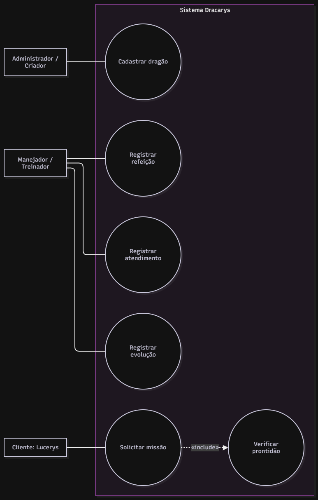

# 4.2.2 Modelagem de Casos de Uso

## Atores

Três papéis interagem com o Dracarys. O ator representa o papel operacional dentro do sistema, e não uma pessoa específica. Embora Lucerys seja o cliente que traz as demandas, no sistema ele atua sob o papel de Cliente.

| Ator | Quem é | O que faz no sistema |
|Administrador / Criador|Responsável geral pelo gerenciamento do ninho|Cadastra os dragões no sistema e gerencia as configurações gerais.|
|Manejador / Treinador |Profissional que cuida do dia a dia e da preparação dos animais|Registra a alimentação, os atendimentos médicos e atualiza a evolução dos treinos.|
|Cliente|Solicitante das missões táticas.| Consulta a lista de dragões, verifica quem está pronto e envia pedidos de missão.|

## Casos de uso

Cada caso de uso é um objetivo direto que um ator alcança ao interagir com o software. Os nomes batem letra por letra com os requisitos funcionais que eles cobrem.

Nem todo requisito precisa virar uma elipse própria no diagrama. O RF05 (Validar prontidão) é um processamento interno que o sistema faz obrigatoriamente antes de liberar uma missão, por isso ele entra como um passo obrigatório (include) ou regra dentro da especificação principal.

| Caso de uso | Ator | Atende |
|---|---|---|
| Cadastrar dragão | Administrador / Criador | RF01 |
| Registrar refeição | Manejador / Treinador | RF02 |
| Registrar atendimento | Manejador / Treinador | RF03 |
|Registrar evolução | Manejador / Treinador | RF04 |
| Solicitar missão | Cliente | RF05 e RF06 |
| Verificar prontidão | nenhum: é incluído por Solicitar missão | Passo compartilhado e obrigatório de validação de regras de saúde/treino. |

## Diagrama de casos de uso

**Figura 1 – Diagrama de casos de uso do Dracarys**

Fonte: Autoria própria (2026).

A Figura 1 mostra a fronteira do sistema com o nome Dracarys. Do lado de fora, temos os três atores. O Administrador se liga a Cadastrar dragão. O Manejador se liga a Registrar refeição, Registrar atendimento e Registrar evolução. O Cliente se conecta a Solicitar missão.

Há uma relação de «include»: o caso Solicitar missão obriga o sistema a passar pelo caso Verificar prontidão para checar os dados do animal. Não há «extend», pois todas as validações de prontidão são obrigatórias para qualquer pedido de decolagem.

## Especificação do caso de uso principal

Solicitar missão é o caso de uso principal do sistema, pois é onde o cliente finalmente valida se todo o trabalho de manejo e treino deu resultado para liberar o dragão para o céu.

| Campo |  |
|---|---|
| Caso de uso | Solicitar missão |
| Ator | Cliente |
| Pré-condição | O dragão deve estar cadastrado no sistema (RF01) e o Cliente deve estar logado no ambiente seguro (RNF02). |
| Pós-condição | A missão é registrada no sistema e o status do dragão muda para "Em Missão", ficando indisponível para novos pedidos. |

**Fluxo principal**

1. O cliente consulta a lista de dragões ativos do ninho.
2. O cliente seleciona o dragão desejado e clica em solicitar missão.
3. O sistema executa a checagem automática dos indicadores («include» Verificar prontidão).
4. O sistema confirma que o dragão cumpriu o treino, comeu na janela de tempo correta e não tem restrição médica (RF05).
5. O cliente confirma os detalhes e o destino da missão
6. O sistema registra a missão e altera o status do dragão para indisponível.

**Fluxo alternativo**

- **A1, no passo 4:O dragão está saudável e alimentado, mas o treino está incompleto.** • Se o nível de risco da missão for baixo, o sistema abre uma tela para o Criador (Administrador) autorizar uma liberação manual de exceção, seguindo para o passo 5.

**Fluxos de exceção**

- **E1, no passo 4: O dragão está em jejum ou doente.** O sistema bloqueia imediatamente o botão de avanço, exibe um alerta vermelho com os dados do atraso (RF06) e impede a solicitação. O caso de uso termina sem a pós-condição. ❓ A confirmar com o cliente: em caso de emergência militar, haverá alguma senha de supervisor que ignore o bloqueio médico?
- **E2, no passo 4: O dragão selecionado já está voando em outra missão.** • O sistema informa o horário previsto de retorno do bicho e não deixa avançar.

## Rastreabilidade com a 4.2.1

| Requisito | Caso de uso | Onde aparece |
|---|---|---|
| RF01 Cadastrar dragão | Cadastrar dragão | elipse própria e pré-condição de Solicitar missão |
| RF02 Registrar refeição | Registrar refeição | elipse própria |
| RF03 Registrar atendimento | Registrar atendimento | elipse própria |
| RF04 Registrar evolução | Registrar evolução | elipse |
| RF05 Validar prontidão | nenhuma elipse | incluído como o passo 4 do fluxo principal de Solicitar missão |
| RF06 Disparar alertas | Solicitar missão / Alertas | elipse de Solicitar missão e detalhado no fluxo de exceção E1 |

**Todo requisito tem lugar.** Cinco viraram elipses com nomes idênticos. O RF05 não virou elipse própria porque ele acontece por trás dos panos como uma regra de negócio obrigatória durante a validação da missão, estando documentado no passo 4 do fluxo.

**Toda elipse tem requisito.**  Não há nenhum caso de uso flutuando sem justificativa na nossa lista de requisitos. A única exceção padrão é o caso "Verificar prontidão", que nasceu puramente da necessidade de modelagem técnica do «include».

**O que a especificação mudou.** Ao escrever os passos do fluxo de exceção (E1), percebemos que o sistema é extremamente rígido sobre a saúde do animal. Isso levantou uma dúvida técnica importante para a próxima reunião com o Lucerys sobre a existência (ou não) de uma chave de liberação forçada para cenários de guerra.