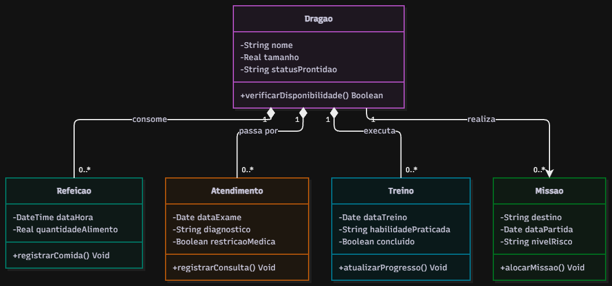

# 4.2.3 Modelagem de Classes

## Dos substantivos às classes

| Substantivo | De onde veio | Vira | Por quê |
|---|---|---|---|
| dragão | RF01 | classe Dragao | É a entidade principal que o sistema precisa gerenciar e lembrar. |
| foto, tamanho, nome | RF01 | atributos de Dragao | São características e detalhes diretos que descrevem o dragão. |
| refeição | RF02 | classe Refeicao | É um evento diário que o sistema precisa registrar e guardar histórico. |
| consulta médica | RF03 | classe Atendimento | É um registro clínico que possui data e detalhes próprios a serem lembrados. |
| treino | RF04 | classe Treino | É uma atividade com evolução contínua que precisa ser armazenada. |
| missão | RF06 / Passo 5 do fluxo | classe Missao | É a alocação estratégica que define o destino e uso do dragão. |
| botão / alerta | RF06 / Exceção E1 | nada | São elementos visuais da interface, não entram no modelo de dados. |

## Classes

| Classe | Atributos | Operações | Veio de |
|---|---|---|---|
| **Dragao** | - nome: String - tamanho: Real - statusProntidao: String | + verificarDisponibilidade(): Boolean | RF01, RF05 |
| **Refeicao** | - dataHora: DateTime - quantidadeAlimento: Real | + registrarComida(): Void | RF02 |
| **Atendimento** | - dataExame: Date - diagnostico: String - restricaoMedica: Boolean | + registrarConsulta(): Void | RF03 |
| **Treino** | - dataTreino: Date - habilidadePraticada: String - concluido: Boolean | + atualizarProgresso(): Void | RF04 |
| **Missao** | - destino: String - dataPartida: Date - nivelRisco: String | + alocarMissao(): Void | RF06 / Passo 5 |

## Diagrama de classes

**Figura 2 – Diagrama de classes do Dracarys**

Fonte: Autoria própria (2026).

A Figura 2 mostra as cinco classes que fazem o sistema funcionar. Lendo as associações como frases: um Dragao pode realizar de zero a muitas (0..*) Missoes, enquanto uma Missao pertence a exatamente um (1) Dragao. O mesmo vale para os cuidados e preparação: um Dragao consome de zero a muitas (0..*) Refeicoes, passa por zero a muitos (0..*) Atendimentos médicos e executa de zero a muitos (0..*) Treinos para evoluir suas habilidades. 

Não há herança no diagrama porque todos os animais seguem as mesmas regras de negócio e campos de cadastro, não existindo tipos especiais de dragões que justifiquem criar subclasses. A relação entre o Dragao e seus históricos de Refeicao, Atendimento e Treino é uma composição (losango cheio do lado do Dragao), pois decidimos que se um dragão for deletado do sistema, todo o seu histórico diário morre junto com ele.

## Teste de objetos

Para testar o modelo, simulamos uma situação real de decolagem de missão do dragão caraxes, de propriedade do cliente Lucerys.

| Objeto | Classe | Valores |
|---|---|---|
| `caraxes` | Dragao | nome = "caraxes", tamanho = 12.5, statusProntidao = "Pronto" |
| `almoço` | Refeicao | dataHora = 27/10/2026 12:00, quantidadeAlimento = 50.0 |
| `checkup` | Atendimento | dataExame = 26/10/2026, diagnostico = "Saudável", restricaoMedica = false |
| `vooTatico` | Treino | dataTreino = 27/10/2026, habilidadePraticada = "Esquiva", concluido = true |
| `missaoPontaTormenta` | Missao | destino = "Ponta Tempestade", dataPartida = 27/10/2026, nivelRisco = "Alto" |

**Ligações:** `caraxes` e `almoço`, `caraxes` e `checkup`, `caraxes` e `vooTatico`, `caraxes` e `missaoPontaTormenta`.

**O que o teste confirma**

- **Um Dragao realiza de zero a muitas Missoes.** O teste confirmou que a estrutura aguenta o cenário real, mostrando que o objeto `caraxes` conseguiu se conectar perfeitamente à sua nova `missaoPontaTormenta` porque o seu atributo `statusProntidao` estava livre e validado pelas amarrações de alimentação e treino anteriores.

## Rastreabilidade com a 4.2.2

| Operação ou atributo | Classe | De onde veio |
|---|---|---|
| verificarDisponibilidade() | Dragao | Passo 3 do caso de uso Solicitar missão |
| registrarComida() | Refeicao | Caso de uso Registrar refeição |
| registrarConsulta() | Atendimento | Caso de uso Registrar atendimento |
| atualizarProgresso() | Treino | Caso de uso Registrar evolução |
| alocarMissao() | Missao | Passo 6 do caso de uso Solicitar missão |
| statusProntidao | Dragao | Passo 4 do caso de uso Solicitar missão |

_Toda operação tem origem? Todo passo do sistema tem casa? O que a modelagem mudou?_
Sim, todas as operações mapeadas vieram direto das ações tomadas nos fluxos dos casos de uso anteriores. A modelagem de classes nos ajudou a perceber que precisávamos criar o atributo `statusProntidao` dentro da classe Dragao. Sem essa informação gravada na memória, o sistema não teria como bloquear um novo pedido se o bicho já estivesse voando pelo céu em outra atividade.
